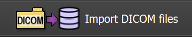
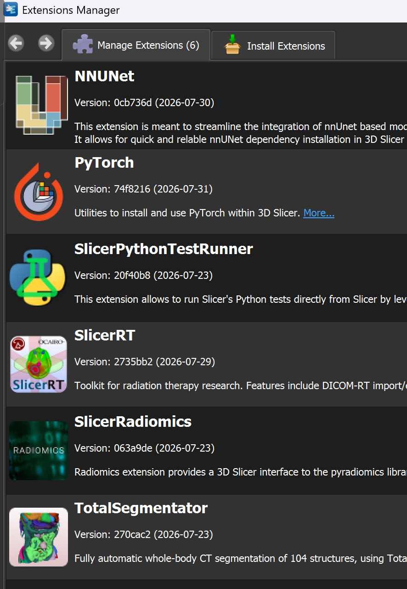
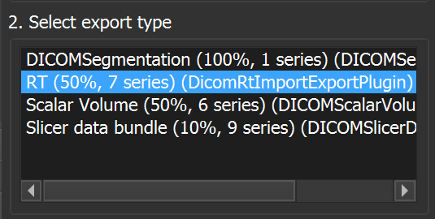

# Ferramentas de segmentação e análise de DICOM

Este repositório reúne três ferramentas: processamento automático com
TotalSegmentator (`Process_DICOMFolder.sh`), cálculo do escore de Agatston e
análise opcional de dose em `CAC.py`, e avaliação geométrica/dosimétrica de
RTSTRUCTs em `avaliacao_auto_segmentacao_rt.py`.

> **Atenção:** os resultados são auxiliares e não substituem a revisão das
> imagens e estruturas por profissionais qualificados. Não use os resultados
> para decisões clínicas sem validação apropriada. Trabalhe apenas com dados
> cujo uso tenha sido autorizado e proteja as informações de saúde.

## 1. Pré-requisitos — comandos para copiar e colar

Escolha o bloco adequado ao que pretende executar. Os comandos Linux devem ser
executados no Ubuntu ou no Ubuntu do WSL, na pasta do repositório. O
processamento automático usa scripts Bash e **não funciona diretamente no
PowerShell ou no Prompt de Comando do Windows**.

### 1.1. Ubuntu ou WSL — pipeline automático, `CAC.py` e visualizador DVH

O bloco instala Python, suporte a janelas e as dependências usadas pelas três
ferramentas. A instalação do TotalSegmentator também configura o PyTorch
necessário; o primeiro uso pode baixar modelos grandes e levar tempo.

```bash
sudo apt update
sudo apt install -y python3 python3-pip python3-venv python3-tk git
python3 -m venv .venv
source .venv/bin/activate
python -m pip install --upgrade pip
python -m pip install TotalSegmentator numpy pandas pydicom rt-utils scipy shapely opencv-python-headless scikit-image matplotlib reportlab pillow
```

Mantenha o ambiente virtual ativado em cada novo terminal antes de executar os
programas. Se estiver usando GPU NVIDIA, confira as instruções oficiais do
PyTorch e do TotalSegmentator para instalar a combinação compatível com o
driver/CUDA da máquina; não copie configurações de CUDA de outro computador.
Para abrir as janelas gráficas no WSL, use uma instalação com suporte a WSLg
ou configure um servidor gráfico compatível.

### 1.2. Windows — somente `CAC.py`

Este bloco é para usar a janela de cálculo CAC no Windows sem WSL. Execute no
PowerShell, a partir da pasta do repositório. Instale antes o Python 3.12 para
Windows com suporte a Tcl/Tk; não é necessário instalar TotalSegmentator para
usar apenas o `CAC.py`.

```powershell
py -3.12 -m venv .venv-cac
& ".\.venv-cac\Scripts\python.exe" -m pip install --upgrade pip
& ".\.venv-cac\Scripts\python.exe" -m pip install numpy pandas pydicom scikit-image reportlab pillow
& ".\.venv-cac\Scripts\python.exe" CAC.py
```

O `reportlab` e o `pillow` habilitam a exportação de relatórios PDF com imagens.
Sem eles, o cálculo pode ser usado, mas a exportação PDF não estará disponível.
Para executar `avaliacao_auto_segmentacao_rt.py` no Windows, use o procedimento da seção 7.1.

## 2. O que cada ferramenta faz

| Ferramenta | Finalidade | Sistema recomendado |
|---|---|---|
| `Process_DICOMFolder.sh` | Executa as segmentações MAMA, META ou PELVE e consolida RTSTRUCTs. | Ubuntu ou WSL |
| `CAC.py` | Calcula escore de Agatston em ROIs cardíacas e, opcionalmente, métricas de RTDOSE. | Windows, Ubuntu ou WSL com interface gráfica |
| `avaliacao_auto_segmentacao_rt.py` | Avalia contornos auto/médicos por geometria e dose, exibe comparação 3D e DVHs. | Windows, Ubuntu ou WSL com interface gráfica |

As ferramentas têm dependências e entradas diferentes. Instale somente o que
for usar, mas não misture arquivos de pacientes, aquisições ou referências
espaciais diferentes.

## 3. Instalar o repositório

Se ainda não tiver uma cópia local, abra o terminal escolhido e clone o
repositório:

```bash
git clone https://github.com/murilogborges/Codigos_AutoSegmentacao.git
cd Codigos_AutoSegmentacao
```

Se o repositório já estiver no computador, apenas abra o terminal na pasta que
contém `Process_DICOMFolder.sh`, `CAC.py` e `avaliacao_auto_segmentacao_rt.py`. No Windows, abra o
Ubuntu/WSL para executar os scripts Bash; a unidade `C:` costuma estar
disponível no WSL em `/mnt/c/`, e outras unidades aparecem sob `/mnt/` conforme
a configuração local.

### 3.1. Conferir a instalação do ambiente Linux

Com o ambiente virtual ativado, valide os comandos e bibliotecas:

```bash
command -v python3
command -v TotalSegmentator
TotalSegmentator --help
python -c "import cv2, matplotlib, numpy, pandas, pydicom, rt_utils, scipy, shapely, skimage"
```

Esses comandos confirmam que o executável e os módulos estão disponíveis no
mesmo ambiente. Se algum comando falhar, corrija a instalação antes de
processar imagens.

### 3.2. Manter o GitHub e os computadores sincronizados

O Git mantém um histórico local e o GitHub guarda uma cópia remota. Os três
comandos têm funções diferentes:

- **`git pull`** baixa e integra no computador os commits que já estão no
  GitHub. Use ao começar a trabalhar e antes de continuar em outro computador.
- **`git commit`** registra no histórico local um conjunto de alterações.
  Use depois de editar e conferir arquivos relacionados. O commit, sozinho,
  **não** envia nada ao GitHub.
- **`git push`** envia ao GitHub commits locais que ainda não foram publicados.
  Use depois de criar e conferir um commit.

O Git não envia automaticamente arquivos ainda não commitados. Além disso,
não sincroniza por si só cópias independentes do repositório, mesmo que elas
estejam em computadores diferentes: para isso, faça `push` na cópia que
recebeu as alterações e depois `pull` na outra.

#### Preparação: clonar ou conferir o repositório

Se ainda não existe uma cópia local, clone uma vez. No Ubuntu/WSL:

```bash
git clone https://github.com/murilogborges/Codigos_AutoSegmentacao.git
cd Codigos_AutoSegmentacao
```

No PowerShell do Windows, use os mesmos comandos:

```powershell
git clone https://github.com/murilogborges/Codigos_AutoSegmentacao.git
Set-Location Codigos_AutoSegmentacao
```

Se a pasta já existe, abra o terminal **dentro dela** e confirme que é um
repositório e que o remoto está configurado:

```text
git status
git remote -v
git branch --show-current
```

`git remote -v` deve mostrar o endereço do GitHub. Se não houver remoto, peça
ao responsável pelo repositório o endereço correto antes de configurar um.
Não inclua senhas ou tokens em comandos, arquivos ou mensagens. Ao pedir
autenticação, use o mecanismo seguro configurado para GitHub (por exemplo,
Git Credential Manager ou chave SSH).

Se esta for a primeira vez que fará commits neste computador, configure o nome
e o e-mail associados ao seu histórico. Use seu próprio nome e o e-mail
cadastrado no GitHub:

```text
git config --global user.name "Seu Nome"
git config --global user.email "seu-email@example.com"
```

#### Rotina recomendada no Ubuntu/WSL

Execute os comandos na pasta do repositório. Ao abrir um terminal novo, entre
na pasta e ative o ambiente Python se for executar os programas:

```bash
cd /caminho/para/Codigos_AutoSegmentacao
git status
git pull --ff-only
```

Faça `pull` antes de editar para começar com a versão mais recente. A opção
`--ff-only` evita criar um commit de merge automaticamente quando as duas
cópias divergiram; se o comando parar, leia a seção **Se houver conflito ou
divergência** antes de continuar. Ative o ambiente virtual apenas quando for
executar os programas Python:

```bash
source .venv/bin/activate
```

Depois das alterações, revise e registre somente os arquivos de código ou
documentação que realmente deseja publicar:

```bash
git status
git diff
git add README.md
git diff --cached
git commit -m "Atualiza documentação de uso"
git push
```

Troque `README.md` pelos arquivos que você editou e deseja publicar. Revise
`git status` e `git diff --cached` antes do commit. Se o `git push` pedir
autenticação, siga a janela ou o fluxo seguro de autenticação configurado.

#### Rotina recomendada no Windows (PowerShell)

Use os mesmos comandos Git no PowerShell, na pasta clonada:

```powershell
Set-Location "C:\caminho\para\Codigos_AutoSegmentacao"
git status
git pull --ff-only
```

Após editar, revise, selecione os arquivos, faça commit e publique:

```powershell
git status
git diff
git add README.md
git diff --cached
git commit -m "Atualiza documentação de uso"
git push
```

Troque `README.md` pelos arquivos que você editou e deseja publicar.
No Windows, Git for Windows precisa estar instalado e disponível no PowerShell.
O ambiente Python virtual é independente do Git: `pull`, `commit` e `push`
não exigem que ele esteja ativado. Ative-o apenas quando for executar o
programa.

#### Trabalhar alternando entre Ubuntu/WSL e Windows

Escolha uma destas formas:

1. **Uma única cópia de trabalho:** use sempre a mesma pasta do repositório
   pelo mesmo ambiente. Antes de alternar entre sistemas, feche programas que
   estejam editando arquivos e confira `git status`. Não faça alterações
   simultâneas na mesma pasta em dois terminais/sistemas.
2. **Uma cópia por sistema/computador:** após salvar alterações na primeira
   cópia, faça `git add`, `git commit` e `git push`. Na outra cópia, execute
   `git pull --ff-only` antes de editar. O `push` publica o commit e o `pull`
   o traz para a outra pasta.

Não suponha que uma pasta sincronizada por nuvem substitua o Git. Serviços de
sincronização de arquivos podem duplicar ou conflitar arquivos internos da
pasta `.git`; use os comandos Git para sincronizar o histórico.

#### Se houver conflito ou divergência

Se `git pull --ff-only` informar que não é possível avançar, não use
`git push --force`. Primeiro confira o estado:

```text
git status
git log --oneline --decorate -5
```

Se ainda houver alterações sem commit, revise-as e faça um commit local antes
de integrar o remoto. Se a divergência for entre commits seus **ainda não
publicados** e commits novos no GitHub, atualize reaplicando seus commits
locais sobre o histórico remoto:

```text
git pull --rebase
```

Se não houver conflitos, o Git termina a atualização. Depois, publique seus
commits:

```text
git push
```

Se o rebase parar por conflito, use `git status` para ver os arquivos
indicados. Abra cada um, compare as partes marcadas por `<<<<<<<`, `=======`
e `>>>>>>>`, escolha o conteúdo correto ou combine as alterações e remova os
marcadores. Marque cada arquivo resolvido e continue:

```text
git add caminho/do/arquivo
git rebase --continue
```

Repita a resolução enquanto houver conflitos. Para cancelar o rebase e voltar
ao estado anterior ao início dele, use:

```text
git rebase --abort
```

Não reescreva commits que já foram publicados ou que outras pessoas estejam
usando sem combinar com a equipe. Se não souber qual conteúdo preservar, pare
e peça ajuda; não descarte alterações para “limpar” o conflito. Se o GitHub
negar permissão para enviar diretamente à branch atual, crie uma branch e
envie-a para abrir um pull request:

```text
git switch -c minha-alteracao
git push -u origin minha-alteracao
```

#### O que não publicar

Antes de cada commit, examine a lista de `git status`. **Nunca adicione ao
GitHub dados DICOM identificáveis, imagens médicas, RTSTRUCTs/RTDOSE de
pacientes, relatórios com dados pessoais, credenciais, tokens, ambientes
virtuais (`.venv`) ou arquivos de modelos baixados.** Mantenha dados e
resultados em pastas fora do repositório ou confirme que estão devidamente
ignorados; não confie apenas em uma pasta estar “local”.

## 4. Preparar os dados DICOM

### 4.1. Exportar a série CT

1. No sistema de origem (por exemplo, XiO), exporte os arquivos DICOM da
   aquisição CT. Use a opção de anonimização quando autorizada e exigida pela
   política institucional. Isso reduz a exposição de identificadores, mas não
   substitui a revisão de privacidade.
2. No 3D Slicer, use **Import DICOM files** para importar o estudo. A imagem
   abaixo indica onde fica a ação de importação.

   

3. Instale pelo gerenciador de extensões somente as extensões necessárias ao
   fluxo escolhido. A captura mostra extensões mencionadas no procedimento de
   referência; a disponibilidade e a necessidade podem mudar conforme a
   versão do Slicer.

   

4. Na sequência DICOM do Slicer, selecione o estudo e escolha **Export to
   DICOM...**. Use uma opção de exportação que preserve a série de imagens CT.
   A tela de referência mostra a opção `RT (50%, 7 series)`; confirme que a
   seleção corresponde ao estudo pretendido.

   

5. Confira a pasta exportada. Para os fluxos deste repositório, a entrada deve
   conter os arquivos da série CT; não use RTDOSE ou RTSTRUCT como se fossem
   imagens CT. Se houver várias séries, separe-as e escolha conscientemente a
   série que será processada.

### 4.2. Organizar uma pasta por execução

1. Crie uma pasta exclusiva para uma série CT de um paciente e copie para ela
   os arquivos da série. Mantenha os arquivos diretamente dentro da pasta, sem
   misturar séries nem pacientes.
2. Verifique se a série está completa e se pertence ao exame esperado.
   Imagens ausentes, cortes duplicados ou geometrias diferentes podem impedir
   a leitura ou comprometer a associação espacial.
3. Dê à pasta final um nome que identifique **exatamente um** dos grupos:
   `MAMA`, `META` ou `PELVE`. A busca não diferencia maiúsculas de
   minúsculas e considera o nome da pasta que será passado ao comando, não o
   nome de uma pasta ancestral.

   Exemplos válidos: `MAMA_Paciente01`, `META01`, `pelve_01`. Um nome como
   `META_MAMA01` é ambíguo e será recusado.

4. Para MAMA, inclua o número do paciente no nome e, se necessário, indique a
   lateralidade junto ao número. `D`, `DIR` ou `LD` indicam direita; `E`,
   `ESQ` ou `LE` indicam esquerda. Exemplos: `MAMAD01`,
   `MAMA01_LD`, `MAMAESQ01` e `MAMA01_LE`. Sem indicação, o arquivo final
   fica sem sufixo. Indicações conflitantes dos dois lados do número são
   recusadas.

## 5. Executar o pipeline automático

Ative o ambiente virtual no Ubuntu/WSL e execute o lançador, informando o
caminho completo da pasta CT. As aspas preservam caminhos com espaços:

```bash
bash ./Process_DICOMFolder.sh "/caminho/para/META01"
```

Use um comando por execução e troque somente o caminho pelo da pasta
preparada:

```bash
bash ./Process_DICOMFolder.sh "/caminho/para/MAMA01"
bash ./Process_DICOMFolder.sh "/caminho/para/PELVE01"
```

O resultado e os intermediários são gravados na pasta informada. O lançador
valida o grupo, confere `TotalSegmentator`, `python3` e as bibliotecas
necessárias, depois chama o fluxo apropriado. As etapas são sequenciais; o
percentual de progresso só avança ao terminar uma tarefa, portanto pode ficar
parado enquanto uma segmentação longa está em execução.

### 5.1. O que é feito em cada grupo

**MAMA**

1. `total` gera `TOTAL_MAMA.dcm` com o subconjunto de estruturas configurado
   em `MAMA_Segmentations.sh`.
2. `breasts` gera `BREASTS.dcm`; `BreastSplit.py` separa a ROI em
   `BREASTS_separado.dcm`, com `Breast_right` e `Breast_left`.
3. `heartchambers_highres` gera `HEART.dcm`; `NothingBreaksLikeAHeart.py`
   prepara `Cardiac_area.dcm`.
4. `coronary_arteries`, `body`, `tissue_4_types`, `headneck_muscles` e
   `liver_lesions` geram, respectivamente, `CORO.dcm`, `BODY.dcm`,
   `TISSUE.dcm`, `MUSC.dcm` e `LIVER.dcm`.
5. `IHaveABody.py` transforma a entrada obrigatória `BODY.dcm` em
   `CORPO.dcm`. A presença de `CORPO.dcm` é necessária para produzir o
   consolidado.
6. `unir_rtstructs.py` combina as entradas preparadas em `GrupoMAMA.dcm`,
   `GrupoMAMA_LD.dcm` ou `GrupoMAMA_LE.dcm`, conforme o nome da pasta.

`HEART.dcm` e `BODY.dcm` são entradas das transformações, não são enviados
diretamente à consolidação. `TISSUE.dcm` é mantido como intermediário, mas não
entra no arquivo final.

**META**

1. As tarefas `total`, `body`, `tissue_4_types`, `head_glands_cavities` e
   `liver_lesions` produzem `TOTAL_META.dcm`, `BODY.dcm`, `TISSUE.dcm`,
   `HEAD.dcm` e `LIVER.dcm`.
2. O programa verifica se `TOTAL_META.dcm` contém a ROI chamada exatamente
   `brain`. Se contiver, tenta também `brain_structures`, `head_muscles` e
   `oculomotor_muscles`, que geram `BRAIN.dcm`, `TONGUE.dcm` e `OPTICS.dcm`.
   Essas tarefas são opcionais e independentes: uma falha não impede as
   demais. Sem a ROI `brain`, as tarefas cerebrais são omitidas.
3. `IHaveABody.py` cria o obrigatório `CORPO.dcm` a partir de `BODY.dcm`.
4. A consolidação reúne as entradas disponíveis, incluindo `CORPO.dcm`, em
   `GrupoMETA.dcm`. `BODY.dcm` e `TISSUE.dcm` não são entradas diretas do
   unificador.

**PELVE**

O grupo PELVE usa as mesmas tarefas e regras do fluxo META. A diferença é o
nome do arquivo final: `GrupoPELVE.dcm`.

### 5.2. Retomada, arquivos existentes e falhas

- Um RTSTRUCT intermediário existente, não vazio e com o nome esperado pode
  ser reutilizado, evitando repetir a tarefa correspondente.
- `CORPO.dcm`, se já existir e não estiver vazio, também é reutilizado.
- O arquivo final **não é sobrescrito**. Se já existir, a execução para para
  proteger os dados anteriores.
- RTSTRUCTs vazios e resíduos NIfTI sem o DICOM correspondente são tratados
  como conflito, não como resultado válido.
- Se uma tarefa opcional falhar ou não produzir o `.dcm` esperado, o pipeline
  tenta as demais e remove os arquivos parciais daquela tarefa. A criação do
  corpo e a consolidação são obrigatórias; falhas nessas etapas interrompem o
  fluxo e exibem diagnóstico.
- Para começar uma nova execução limpa, prefira criar uma nova pasta de
  trabalho. Se for necessário arquivar ou mover saídas antigas, confira cada
  arquivo antes; não apague a pasta de entrada indiscriminadamente.

O unificador verifica se os RTSTRUCTs são compatíveis quanto a paciente,
estudo, série CT e Frame of Reference. Não combine arquivos de exames ou
espaços físicos diferentes. Contornos inválidos podem ser ignorados enquanto
os contornos válidos continuam sendo processados; se não houver entradas
utilizáveis, não será possível criar o consolidado.

## 6. Análise de Agatston e dose com `CAC.py`

O `CAC.py` abre uma interface gráfica. Ele calcula o escore de Agatston nas
ROIs cardíacas reconhecidas nos RTSTRUCTs selecionados. Também pode calcular
métricas de dose se for fornecido um RTDOSE. Não é uma ferramenta de
segmentação automática.

Inicie-o com o ambiente preparado:

```bash
python3 CAC.py
```

No Windows, use o comando `& ".\.venv-cac\Scripts\python.exe" CAC.py` mostrado
na seção 1.2.

### 6.1. Passo a passo na janela

1. **Escolha a pasta CT.** Selecione a pasta que contém os arquivos DICOM da
   série. O programa lê os arquivos nessa pasta, agrupa as imagens por série e
   valida a geometria.
2. **Escolha a série.** Se houver mais de uma série CT válida, selecione uma
   única série. Séries diferentes não são combinadas.
3. **Selecione um ou mais RTSTRUCTs.** O programa verifica se os arquivos
   contêm ROIs com contornos e referências à série CT selecionada. Selecione
   apenas RTSTRUCTs do mesmo estudo e espaço físico.
4. **Selecione um RTDOSE ou continue sem dose.** Sem RTDOSE, o escore CAC
   ainda pode ser calculado. Para métricas de dose, o arquivo precisa conter
   dose física absoluta em Gy ou cGy, estar associado à CT e cobrir
   integralmente cada estrutura analisada.
5. **Confira os resultados.** A tabela é ordenada pelo escore. Use **Copiar
   todos os dados** para copiar os resultados ou **Salvar relatório em
   PDF...** para exportá-los. Após salvar, **Abrir PDF gerado** abre o relatório
   mais recente.

### 6.2. Como interpretar as medidas

- São analisadas ROIs cardíacas reconhecidas em português ou inglês, como
  coração, área cardíaca, miocárdio, átrios, ventrículos, aorta, artérias
  coronárias, artéria pulmonar e veia pulmonar. ROIs não cardíacas não entram
  no escore CAC.
- O algoritmo procura agrupamentos conectados com pelo menos quatro pixels e
  densidade acima de 129 HU dentro de cada ROI. O escore soma a área dos
  pixels, ponderada pelo fator de densidade máxima do agrupamento: 130–199 HU
  (1), 200–299 HU (2), 300–399 HU (3) e 400 HU ou mais (4).
- O volume associado é calculado com área do pixel e espaçamento entre cortes.
  Por isso, a geometria e as unidades DICOM precisam estar corretas.
- A dose média é ponderada pelo volume dos voxels. D0,5cc representa a dose
  no volume mais quente de 0,5 cm³ e não é calculada para estruturas menores
  que esse volume. A dose é interpolada nos centros dos voxels CT.
- O RTDOSE selecionado não é somado a outros arquivos ou frações. Se não
  cobrir integralmente uma estrutura, as métricas correspondentes são
  recusadas em vez de calculadas sobre cobertura parcial.
- Se os Frames of Reference do RTDOSE e da CT forem diferentes, o aplicativo
  ainda pode tentar amostrar pelas coordenadas físicas numéricas, mas não faz
  registro espacial. Confirme que ambos estão no mesmo espaço antes de
  interpretar o resultado.
- Quando disponível a ROI `Área cardíaca`, o aplicativo também compara V8 Gy,
  V16 Gy e V20 Gy com limites de referência do RTOG 1005 (Arm II). A
  lateralidade é inferida pela mama lateralizada com maior dose média; se não
  for possível identificá-la, os limites não são avaliados. Esses indicadores
  não substituem a revisão do protocolo clínico.

A exportação de PDF inclui a tabela, a explicação dos fatores do escore e,
para estruturas com escore maior que zero, recortes CT com calcificações
destacadas. Instale `reportlab` e `pillow` para habilitar a criação de PDF.

## 7. Avaliação geométrica, 3D e dosimétrica com `avaliacao_auto_segmentacao_rt.py`

O aplicativo compara estruturas auto-segmentadas e contornos de referência
médica, calcula métricas geométricas e dose-volume e exibe uma comparação 3D.
Instale as dependências listadas no repositório:

```bash
python3 -m pip install -r requirements-dvh.txt
python3 avaliacao_auto_segmentacao_rt.py
```

Use Python 3.10 ou superior. A instalação feita na seção 1 já inclui essas
bibliotecas; o comando acima também serve para instalar ou atualizar somente
as dependências do visualizador.

No Windows, crie um ambiente virtual próprio no PowerShell e execute:

```powershell
py -3.12 -m venv .venv-dvh
& ".\.venv-dvh\Scripts\python.exe" -m pip install --upgrade pip
& ".\.venv-dvh\Scripts\python.exe" -m pip install -r requirements-dvh.txt
& ".\.venv-dvh\Scripts\python.exe" avaliacao_auto_segmentacao_rt.py
```

### 7.1. Preparar a análise

1. Na janela, selecione a pasta que contém a série CT, o RTDOSE e os
   RTSTRUCTs. Se estiverem em pastas diferentes, use os botões de seleção
   manual para a dose e para cada RTSTRUCT.
2. Selecione explicitamente a CT, o RTDOSE, o RTSTRUCT de auto-segmentação e
   o RTSTRUCT de referência médica. Arquivos RTDOSE cujo nome começa com
   `DOSE` e RTSTRUCTs cujo nome começa com `SS` são selecionados
   automaticamente quando encontrados; arquivos com prefixo `TOTAL_` podem
   ser sugeridos para auto-segmentação.
3. Confira as listas de ROIs e selecione estruturas correspondentes nos dois
   RTSTRUCTs. ROIs com `PTV` no nome são pré-selecionadas na referência,
   quando encontradas. Informe a dose de prescrição em Gy; ela é obrigatória
   para calcular o DVH e as métricas.
4. Clique em **Iniciar análise 3D**. Aguarde o processamento das superfícies;
   a janela 3D aparece quando essa etapa terminar.
5. Avalie a sugestão de ROIs automáticas com pelo menos 60% do volume dentro
   da união dos PTVs. Aceite ou recuse a sugestão e ajuste as caixas de
   seleção. A visualização e o DVH consideram as estruturas marcadas.

### 7.2. Visualização, tabela e DVH

- A visualização 3D mostra auto-segmentação, comparação e PTVs. Na comparação,
  verde claro é a interseção, verde escuro é a parte da auto-segmentação fora
  da referência e amarelo semitransparente (50%) é a parte da referência fora
  da auto-segmentação. A rotação é sincronizada entre as vistas; use a roda do
  mouse sobre qualquer vista para aproximar ou afastar as estruturas.
- **Métricas por estrutura** mostra, em três linhas por ROI automática
  (original, +0,5 cm e +1,0 cm), o percentual dentro da referência, o volume e
  a razão dos parâmetros dosimétricos em relação ao PTV médico original:
  dose média, dose máxima, D98/D95/D50/D2 e Vprescrição. Uma razão 1,000
  indica valor igual ao PTV; valores abaixo ou acima indicam, respectivamente,
  valores menores ou maiores. Essa tabela não reporta Dice, Hausdorff,
  distância média de superfície nem volumes/diferença volumétrica auto versus
  médico.
- **Calcular DVH** calcula somente quatro curvas: PTV original, união das
  estruturas automáticas e essa união expandida em 0,5 e 1,0 cm. O botão
  **Mostrar subestruturas**, dentro da janela DVH, permite selecionar contornos
  automáticos e médicos individuais para sobrepor às curvas principais.
- Os botões de exportar CSV e salvar os dois gráficos ficam dentro da janela
  DVH e exportam as curvas atualmente exibidas. O CSV começa com a coluna
  `PatientID`.
- A janela 3D tem um botão para salvar a figura completa da comparação em PNG.
- **Resumo dosimétrico** abre uma tabela integrada, com o `PatientID` extraído
  da CT na primeira coluna. Ela reúne volume, dose média/máxima, D98, D95,
  D50, D2 e Vprescrição, além de Dice, Hausdorff, distância média de
  superfície, volumes auto/médico e diferença volumétrica. As expansões
  automáticas são comparadas com a referência médica original, sem expandir
  essa referência.
- **Métricas por estrutura** apresenta, para cada estrutura automática,
  percentual dentro da referência, volume e razões dos parâmetros de dose
  relativos ao PTV médico original. A referência (PTV) permanece sem expansão.
  Os valores numéricos dessa tabela usam vírgula decimal. O `PatientID` é a
  primeira coluna. A tabela permite salvar CSV, copiar com cabeçalho pelo
  botão **Copiar** ou copiar sem cabeçalho; os textos explicativos ficam
  disponíveis pelo botão **?**.
- Ao descobrir os arquivos e antes das análises, o aplicativo compara o
  `PatientID` da CT, RTDOSE e RTSTRUCTs selecionados. IDs diferentes ou
  ausentes são informados no console, identificando o arquivo e o ID; IDs
  iguais não geram mensagem. Os nomes sugeridos para arquivos salvos começam
  com o ID do paciente e um sublinhado.
- Para o DVH da união, as expansões são limitadas à ROI `patient` erodida em
  0,5 cm. Se ela não existir, o programa permite escolher uma estrutura
  substituta, que também será erodida. As análises por estrutura não expandem
  nem recortam a referência PTV.
- A barra de status e o indicador percentual mostram o progresso do
  processamento.

Frame of Reference ou referências de imagem ausentes/diferentes podem gerar
avisos; o programa pode tentar a associação pelas coordenadas físicas, mas
isso não equivale a registro. Séries CT com espaçamento irregular e dose sem
cobertura dos pontos necessários não devem ser interpretadas como se fossem
válidas.

## 8. Testes do projeto

Com as dependências instaladas e o ambiente virtual ativado, execute a suíte
de testes:

```bash
python -m unittest discover -s tests -v
```

Os testes verificam partes do processamento DICOM, incluindo ordenação de
cortes, associação de estruturas, dose e cálculos. Eles não substituem a
validação visual dos resultados em estudos reais.

## 9. Licenças, privacidade e limitações

- Consulte os termos de uso e licenças de cada tarefa do TotalSegmentator
  antes de usá-la. Algumas tarefas podem ter restrições específicas, inclusive
  para uso comercial. Consulte a [documentação oficial do
  TotalSegmentator](https://github.com/wasserth/TotalSegmentator) e a
  [página de licenças acadêmicas](https://backend.totalsegmentator.com/license-academic/).
- O primeiro uso do TotalSegmentator pode baixar pesos de modelo. Verifique
  as regras de rede e de privacidade da instituição. A documentação oficial
  explica como configurar as estatísticas de uso.
- Não envie imagens, identificadores ou outros dados de saúde a serviços
  externos sem autorização. Proteja também as pastas de entrada, os
  intermediários e os relatórios gerados.
- As ferramentas não fazem diagnóstico nem validam automaticamente todos os
  contornos. Artefatos, protocolo, cobertura anatômica e qualidade da imagem
  podem afetar os resultados. Confira as imagens, unidades, referências
  espaciais e estruturas em um visualizador DICOM apropriado.
- O arquivo consolidado é construído a partir das entradas válidas e das
  regras do unificador; não é necessariamente uma cópia de todas as estruturas
  dos RTSTRUCTs originais.

## 10. Referências técnicas

- [TotalSegmentator — instalação, tarefas, opções e licenças](https://github.com/wasserth/TotalSegmentator)
- [Pesquisa de tarefas e estruturas do TotalSegmentator](https://backend.totalsegmentator.com/find-task/)
- [Extensão TotalSegmentator para 3D Slicer](https://github.com/lassoan/SlicerTotalSegmentator)
- [nnU-Net — implementação e documentação](https://github.com/MIC-DKFZ/nnUNet)

O artigo geral do TotalSegmentator é: WASSERTHAL, Jakob et al.
*TotalSegmentator: robust segmentation of 104 anatomic structures in CT
images*. Radiology: Artificial Intelligence, v. 5, n. 5, e230024, 2023.
DOI: [10.1148/ryai.230024](https://doi.org/10.1148/ryai.230024). Consulte a
documentação da versão utilizada para obter as referências específicas das
tarefas e dos modelos empregados.
